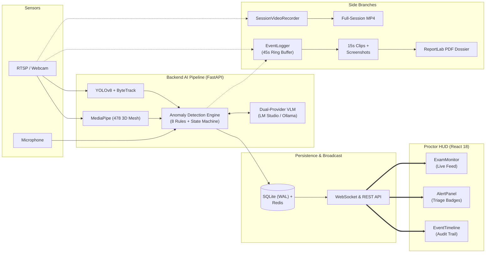
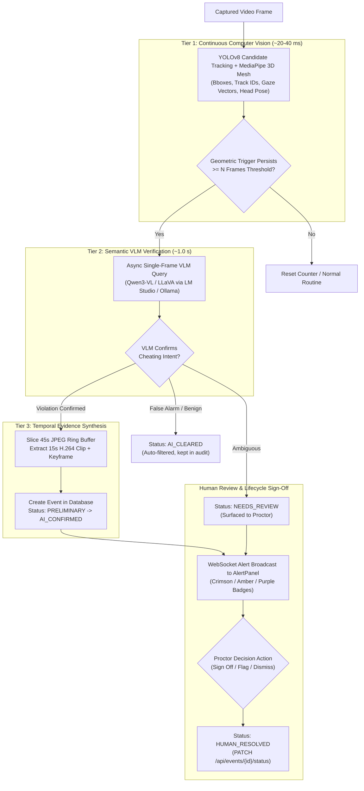
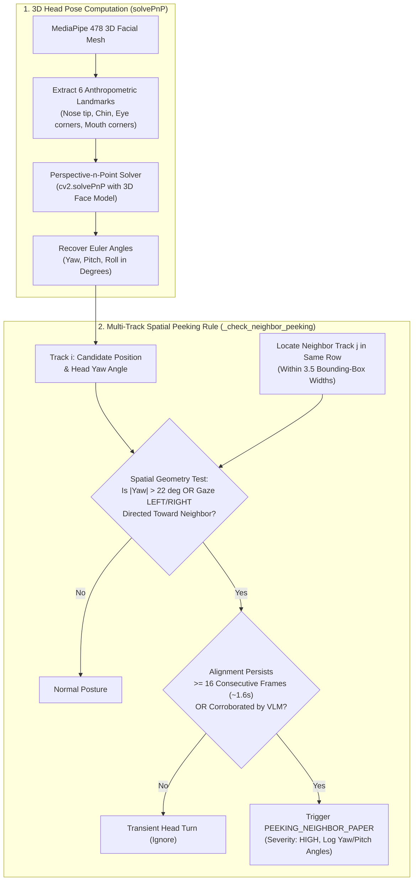
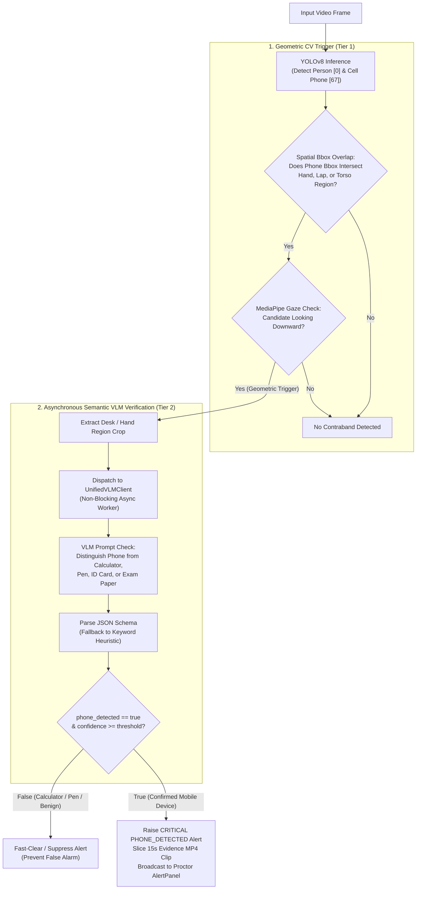

# Chapter 2 — Methodology: Architectural Diagrams and Flowcharts

This document compiles all **5 formal methodology figures** for Chapter 2 of the **ARGUS Surveillance Platform** report/thesis.

> [!TIP]
> **How to copy and use these figures:**
> - **In Markdown / Obsidian / GitHub**: The diagrams below will automatically render into interactive, scalable graphics.
> - **For Word / LaTeX / Google Docs**: Open [mermaid.live](https://mermaid.live), paste any code block below, and click **Download PNG (High Res)** or **Download SVG** to insert directly into your document.

---

## Figure 2.1: End-to-End System Architecture of ARGUS Surveillance Platform

**Figure Caption:**  
*Figure 2.1: End-to-End System Architecture of ARGUS Surveillance Platform. Illustrating multi-stream sensor ingestion, real-time edge AI inference, decoupled background session recording, rolling 45-second forensic ring buffer, write-ahead logging persistence, and low-latency token-authenticated WebSocket broadcasting to the tactical React 18 HUD.*

---

## Figure 2.2: Thread-Safe Video Frame Queue and Audio Decibel Ingestion Flowchart

```mermaid
flowchart TB
    %% Video Pipeline
    subgraph VIDEO["Video Stream Ingestion (CameraManager)"]
        V_IN["RTSP / USB Video Stream\n(30 FPS)"] --> CAP_THREAD["Dedicated Background\nCapture Thread"]
        CAP_THREAD --> QUEUE{"FIFO Frame Queue\n(Buffer Size = 15)"}
        QUEUE -->|"If Queue Full"| DROP["Discard Stale Frame\n(Zero Latency)"]
        QUEUE -->|"Pop Frame"| PREP["Frame Preprocessing\n(Resize to 640x480, BGR->RGB, Norm [0,1])"]
        
        PREP --> DET_IN["YOLOv8 & MediaPipe\nDetection Engine"]
        PREP -.-> RING["45s JPEG Ring Buffer\n(Quality 80, ~19MB RAM)"]
        PREP -.-> SESS["SessionVideoRecorder\n(Queue capacity 180)"]
    end

    %% Audio Pipeline
    subgraph AUDIO["Acoustic Telemetry Ingestion (AudioLevelService)"]
        A_IN["Hall Microphone\n(16 kHz Mono Input)"] --> BLOCKS["100 ms Sample Blocks\n(1,600 Samples per Window)"]
        BLOCKS --> RMS["Compute Root Mean Square\nRMS = sqrt(sum(x^2)/N)"]
        RMS --> DB["Decibel Conversion\ndB = 20 * log10(RMS / Ref)"]
        DB --> EMA["Exponential Moving Average\nSmoothing Filter"]
        EMA --> TELEM["Broadcast Live dB\nTelemetry to HUD"]
        EMA --> AUDIO_CHECK{"Smoothed dB > 65 dB\nfor > 2.0 Seconds?"}
        AUDIO_CHECK -->|"Yes"| AUD_ALERT["Raise AUDIO_ANOMALY\n(Severity: HIGH)"]
        AUDIO_CHECK -->|"No"| AUD_PASS["Normal Ambient Room Level"]
    end
```

**Figure Caption:**  
*Figure 2.2: Thread-Safe Video Frame Queue and Audio Decibel Ingestion Flowchart. Showing non-blocking FIFO queueing with automatic frame-drop on saturation, dual fan-out to the ring buffer and session recorder, and dynamic 100 ms acoustic window RMS computation with exponential smoothing.*

---

## Figure 2.3: Multi-Tier Anomaly Escalation and Verification Flow

**Figure Caption:**  
*Figure 2.3: Multi-Tier Anomaly Escalation and Verification Flow. Illustrating high-recall Tier 1 CV triggers, asynchronous Tier 2 semantic VLM filtering, Tier 3 15-second temporal evidence slicing, and the formal AnomalyStatus lifecycle leading to proctor resolution.*

---

## Figure 2.4: 3D Head Pose Euler Vector Computation and Neighbour Peeking Spatial Geometry

**Figure Caption:**  
*Figure 2.4: 3D Head Pose Euler Vector Computation and Neighbour Peeking Spatial Geometry. Demonstrating Perspective-n-Point facial landmark orientation solver and multi-track spatial row adjacency filtering for neighbour peeking detection.*

---

## Figure 2.5: Phone Detection Pipeline Combining Bounding Box Intersection and VLM Verification

**Figure Caption:**  
*Figure 2.5: Phone Detection Pipeline Combining Bounding Box Intersection and VLM Verification. Combining COCO class-67 bounding box overlap with candidate hand/lap coordinates, downward optical gaze confirmation, and targeted VLM visual differentiation.*
