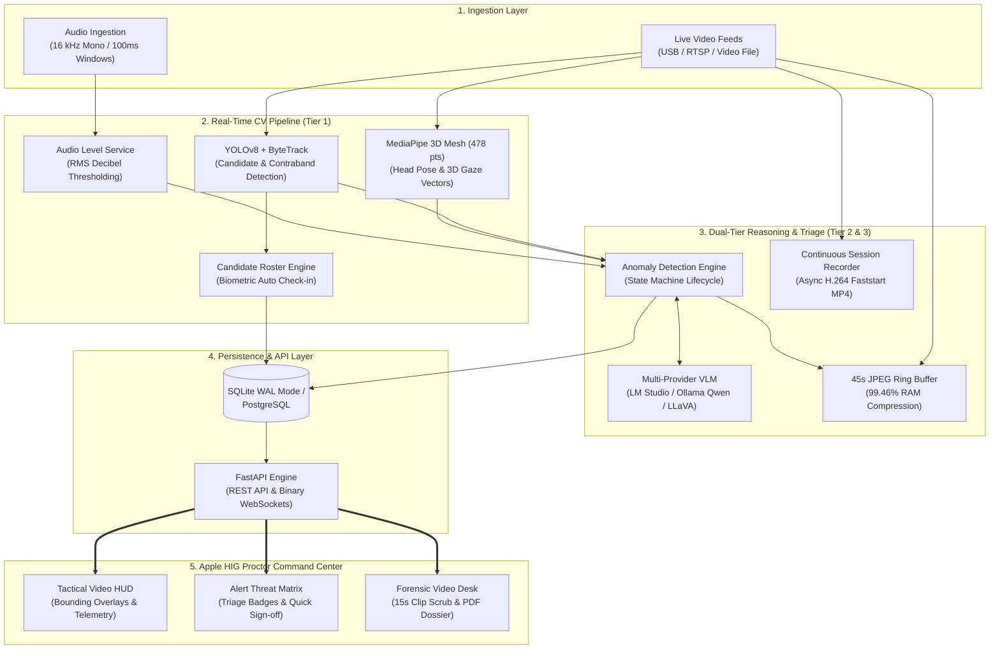
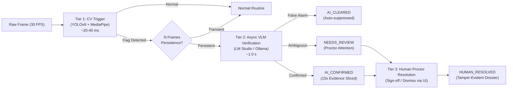

# ARGUS — Autonomous AI Exam Surveillance System

[](https://www.python.org/)
[](https://fastapi.tiangolo.com/)
[](https://reactjs.org/)
[](https://ultralytics.com/)
[](https://developers.google.com/mediapipe)
[](https://lmstudio.ai/)
[](LICENSE)

An autonomous AI-powered exam surveillance and proctoring platform named after **Argus Panoptes** — the all-seeing hundred-eyed giant of Greek mythology. **ARGUS** monitors exam environments in real-time, detects behavioral anomalies using state-of-the-art computer vision and Vision-Language Models (VLMs), manages live candidate attendance, records full-length exam sessions asynchronously, and generates tamper-evident forensic compliance dossiers for academic institutions and certification centers.

---

## 📑 Table of Contents
1. [Key Capabilities](#-key-capabilities)
2. [Formal Architecture & Methodology](#-formal-architecture--methodology)
3. [Quick Start](#-quick-start)
   - [Option A: 1-Click Unified Launch (Windows)](#option-a-1-click-unified-launch-windows)
   - [Option B: Dedicated Launchers](#option-b-dedicated-launchers)
   - [Option C: Manual CLI Step-by-Step](#option-c-manual-cli-step-by-step)
4. [Default Test Accounts](#-default-test-accounts)
5. [VLM Configuration Guide (LM Studio & Ollama)](#-vlm-configuration-guide)
6. [Anomaly State Machine & Triage Lifecycle](#-anomaly-state-machine--triage-lifecycle)
7. [Continuous Session Recording & Forensic Re-Analysis](#-continuous-session-recording--forensic-re-analysis)
8. [API Reference](#-api-reference)
9. [Project Directory Layout](#-project-directory-layout)
10. [Testing & Quality Verification](#-testing--quality-verification)
11. [Production Scaling Roadmap](#-production-scaling-roadmap)
12. [License](#-license)

---

## 🌟 Key Capabilities

### 1. Tactical Multi-Person Computer Vision
- **YOLOv8 + ByteTrack**: Real-time multi-candidate detection, spatial bounding-box tracking, and persistent tracking IDs (`TRK #...`) across transient occlusions and frame drops.
- **Unauthorized Item Detection**: Autonomous detection of cell phones, concealed cheat sheets, wearable smart devices, and books.
- **MediaPipe 3D Face Landmarker**: High-fidelity 478-point facial mesh computing head pose (pitch, yaw, roll), abnormal posture departures, calibrated 3D optical eye gaze vectors ($\theta_{\text{pitch}}$, $\theta_{\text{yaw}}$ in degrees), and face obscuration checks.
- **Decibel Audio Telemetry**: Microphone RMS sound level capture (dB) with dynamic 100ms sampling windows (1,600 samples at 16 kHz) for speech and ambient disturbance alerting.

### 2. Multimodal VLM Semantic Reasoning
- **Multi-Provider VLM Engine**: Unified visual reasoning client supporting both local **LM Studio** (`/v1`) and **Ollama** (`/api/generate`) with automatic model discovery (`/models`, `/api/tags`) and structured JSON schema parsing.
- **Deep Contextual Inspection**: Suspicious candidate crops are routed to Vision-Language Models (e.g. Qwen2.5-VL, Qwen3-VL, LLaVA, Moondream) to eliminate false positives and verify cheating intent (hidden earpieces, whispering, peeking).
- **Forensic Reasoning Logs**: Every flagged infraction includes natural language proctor notes and VLM rationales attached to the incident record.

### 3. Live Dynamic Candidate Roster & Attendance Desk
- **Automated Cohort Seeding**: Instantly generates enrolled student cohorts with registration IDs, roll numbers, and seat coordinates.
- **Biometric CV Auto Check-In**: When a candidate enters the camera frame, the detection engine automatically binds the detection track to the student record, marks them `CHECKED_IN`, and records their arrival timestamp.
- **Proctor Attendance Desk**: Search candidates by name or seat, toggle check-ins, or trigger 1-click **"Mark All Present"** batch verification.
- **Global Attendance Telemetry**: Live verified ratio meters (e.g., `29 of 30 Verified · 97%`) visible across the top command bar and workspace tabs.

### 4. Apple HIG Command Center & Anomaly Triage
- **Apple Human Interface Design System**: Clean, clinical Cupertino-inspired aesthetic (`#f5f5f7` canvas, `#ffffff` elevated squircle cards, 0.5px hairline borders, and SF Pro/Inter typography) with built-in Apple Dark Pro mode support.
- **Tactical Camera Monitor HUD**: High-tech feed framing with resolution badges (`LIVE 1080p · 30 FPS`), tactical bounding box overlays, and live stream latency indicators.
- **Anomaly State Machine Triage**: Dynamic visual badges and filterable status lifecycle (`PRELIMINARY`, `AI_CONFIRMED`, `AI_CLEARED`, `NEEDS_REVIEW`, `HUMAN_RESOLVED`, `ERROR`) with 1-click proctor sign-off.
- **Auditor Video Inspection Desk**: Scrub recorded evidence clips frame-by-frame with custom timecode playback and speed controls.

### 5. Continuous Session Recording, Forensics & Media Exports
- **Continuous Full Exam Session Recording**: Thread-decoupled async recording engine (`SessionVideoRecorder`) with UI toggle, saving entire exam sessions into browser-playable faststart H.264 MP4 format with zero frame drop in surveillance.
- **1-Click Whole-Exam Re-Analysis**: Launch post-hoc forensic video audit scans (`POST /api/exams/{id}/reanalyze`) over recorded sessions with interactive timecode-indexed incident heatmaps.
- **JPEG-Compressed Ring Buffer**: 45-second circular ring buffer in RAM with 99.46% memory compression (~19 MB per camera), extracting 15-second MP4 evidence clips on demand.
- **Exportable PDF Compliance Dossiers**: Server-side ReportLab document synthesis including session telemetry, infraction breakdowns, candidate risk scorecards, and keyframe evidence snapshots.
- **Media Evidence Exports**: 1-click downloads for full exam session MP4 recordings, 15s incident clips, high-resolution keyframes, and raw structured `.json` telemetry.

### 6. Role-Based Access Control (RBAC) & Governance
- **Three Tiered Profiles**: `Administrator` (system settings & staff management), `Chief Auditor` (forensic reviews & compliance downloads), and `Exam Proctor` (live monitoring & flags).
- **Two-Man Rule Governance**: Sensitive actions (e.g., ending exams or audit log overrides) require secondary sign-off.

---

## 🏛️ Formal Architecture & Methodology

ARGUS is designed around a multi-tier decoupled surveillance architecture. Comprehensive formal diagrams for research papers and IEEE-style project reports are maintained in [CHAPTER_2_DIAGRAMS.md](CHAPTER_2_DIAGRAMS.md) and [MASTER_PROCTORING_ARCHITECTURE.md](MASTER_PROCTORING_ARCHITECTURE.md).

```
┌─────────────────────────────────────────────────────────────┐
│                    ARGUS ARCHITECTURE                       │
└─────────────────────────────────────────────────────────────┘

┌──────────────────────────────────────────────────────────────┐
│                    INPUT LAYER                               │
├──────────────────────────────────────────────────────────────┤
│  • Camera feeds (USB / RTSP / IP cameras / Video files)      │
│  • Microphone audio capture (100ms / 1,600 sample RMS dB)    │
│  • System clock synchronization (UTC)                        │
└──────────────────────────────┬───────────────────────────────┘
                               │
       ┌───────────────────────┴───────────────────────┐
       ▼                                               ▼
┌──────────────────────────────────────────┐   ┌───────────────────────────┐
│       AI COMPUTER VISION PIPELINE        │   │  CONTINUOUS RECORDING     │
├──────────────────────────────────────────┤   │  (SessionVideoRecorder)   │
│ ┌──────────────────────────────────────┐ │   │ • Thread-decoupled Queue  │
│ │ YOLOv8 + ByteTrack Spatial Tracking  │ │   │ • Zero display frame drop │
│ │ • Person, phone, cheat sheet boxes   │ │   │ • Faststart H.264 MP4     │
│ │ • Candidate Roster Auto Check-In     │ │   │ • UI Recording Toggle     │
│ └──────────────────┬───────────────────┘ │   └─────────────┬─────────────┘
│                    ▼                     │                 │
│ ┌──────────────────────────────────────┐ │                 │
│ │ 3D FACIAL & GAZE ANALYSIS            │ │                 │
│ │ • MediaPipe 478 3D landmarks         │ │                 │
│ │ • Optical gaze vector (yaw/pitch deg)│ │                 │
│ │ • Head pose & face obscuration check │ │                 │
│ └──────────────────┬───────────────────┘ │                 │
│                    ▼                     │                 │
│ ┌──────────────────────────────────────┐ │                 │
│ │ MULTI-PROVIDER VLM REASONING         │ │                 │
│ │ • LM Studio + Ollama dual support    │ │                 │
│ │ • Dynamic model discovery            │ │                 │
│ │ • Structured JSON semantic audit     │ │                 │
│ └──────────────────┬───────────────────┘ │                 │
│                    ▼                     │                 │
│ ┌──────────────────────────────────────┐ │                 │
│ │ ANOMALY ENGINE & 45s RING BUFFER     │ │                 │
│ │ • State Machine (PRELIM -> RESOLVED) │ │                 │
│ │ • 99.46% RAM JPEG compression        │ │                 │
│ │ • 15s MP4 incident clip synthesis    │ │                 │
│ │ • Real-time WebSocket broadcasting   │ │                 │
│ └──────────────────────────────────────┘ │                 │
└──────────────────────┬───────────────────┘                 │
                       │                                     │
                       └──────────────────┬──────────────────┘
                                          ▼
┌──────────────────────────────────────────────────────────────┐
│                  DASHBOARD & REPORTING                       │
├──────────────────────────────────────────────────────────────┤
│  • Tactical Camera Monitor HUD (Real-time annotated stream)  │
│  • Candidate Roster & Attendance Desk (Live check-in/out)    │
│  • Anomaly Threat Feed with State Machine Triage Badges      │
│  • Telemetry & Risk Analytics (Interactive Recharts charts)  │
│  • Searchable Chronological Audit Timeline                   │
│  • Forensic Inspection Desk with 15s MP4 playback & keyframes│
│  • Continuous Session Recording Download & 1-Click Re-Audit  │
│  • Exportable PDF Compliance Dossier & Structured JSON       │
└──────────────────────────────────────────────────────────────┘
```

### Formal Methodology Flowcharts



#### Multi-Tier Anomaly Escalation & Verification Flow


> [!NOTE]
> Additional formal IEEE/university project report diagrams (including Head Pose Euler vectors, Neighbour Peeking spatial geometry, and Frame Queue thread models) are available in [CHAPTER_2_DIAGRAMS.md](CHAPTER_2_DIAGRAMS.md).

---

## 🚀 Quick Start

### Prerequisites
- Python 3.10+ (managed via `pip`, `uv`, or virtual environment)
- Node.js 18+ and npm
- USB webcam, RTSP stream, or test video file
- *(Optional)* NVIDIA GPU with CUDA for accelerated YOLOv8 & MediaPipe inference
- *(Optional)* [LM Studio](https://lmstudio.ai/) or [Ollama](https://ollama.com/) for VLM inspection

---

### Option A: 1-Click Unified Launch (Windows)

The repository includes an automated master batch script that auto-detects Python, ensures the local SQLite database directory exists, initializes `.env` from `.env.example`, and launches both Backend and Frontend servers concurrently:

```cmd
# 1. Clone repository
git clone https://github.com/devwithsujay/Real-Time-Exam-Surveillance-System.git
cd Real-Time-Exam-Surveillance-System

# 2. Install dependencies (First-time only)
pip install -r requirements.txt
cd frontend && npm install && cd ..

# 3. Double-click or run:
start_project.bat
```
* **Frontend Dashboard**: Launches automatically at `http://localhost:3000`
* **Backend API Docs**: Running at `http://127.0.0.1:8000/docs`
* **Stop all services**: Run `stop_project.bat`

---

### Option B: Dedicated Launchers

If you prefer launching individual services in separate terminals:

```cmd
# Launch Backend in its own window
run_backend.bat

# Launch Frontend in its own window
run_frontend.bat
```

---

### Option C: Manual CLI Step-by-Step

#### 1. Backend Server
```bash
# Activate virtual environment if configured
# Windows: venv\Scripts\activate
# Linux/macOS: source venv/bin/activate

# Install Python requirements
pip install -r requirements.txt

# Run FastAPI with Uvicorn
uvicorn backend.app.main:app --host 127.0.0.1 --port 8000 --reload
```

#### 2. Frontend Dashboard
```bash
cd frontend
npm install
npm start
```

---

## 👥 Default Test Accounts

Staff accounts are automatically seeded into the database on first startup:

| Role | Username | Default Password | Permissions |
| :--- | :--- | :--- | :--- |
| **Administrator** | `admin` | `Admin@12345` | Full system governance, staff directory management, exam hall creation |
| **Chief Auditor** | `auditor1` | `Auditor@12345` | Forensic evidence review, PDF compliance export, audit log inspection |
| **Exam Proctor** | `proctor1` | `Proctor@12345` | Live video HUD, attendance desk, real-time anomaly triage & sign-off |

---

## 🧠 VLM Configuration Guide

ARGUS features a **multi-provider VLM client** (`backend/app/services/vlm_client.py`) supporting both **LM Studio** and **Ollama**.

In your `.env` file or environment variables:

```env
# Multi-Provider Toggle: "lmstudio" or "ollama"
VLM_ENABLED=true
VLM_PROVIDER=lmstudio

# --- LM Studio Configuration ---
VLM_BASE_URL=http://127.0.0.1:1234/v1
VLM_MODEL=qwen/qwen3-vl-4b
VLM_MAX_TOKENS=512
VLM_TIMEOUT=60

# --- Ollama Configuration ---
OLLAMA_BASE_URL=http://localhost:11434
OLLAMA_MODEL=llava:latest
```

### Running with LM Studio
1. Open LM Studio and start the local server on `http://127.0.0.1:1234`.
2. Load any vision model (e.g. `qwen2.5-vl-7b-instruct`, `qwen3-vl-4b`, or `moondream2`).
3. Set `VLM_PROVIDER=lmstudio` in `.env`.

### Running with Ollama
1. Install and start Ollama (`ollama run llava`).
2. Set `VLM_PROVIDER=ollama` and `OLLAMA_MODEL=llava:latest` in `.env`.

---

## ⚡ Anomaly State Machine & Triage Lifecycle

To prevent false alarms from skewing exam integrity records, ARGUS implements a 6-stage Anomaly State Machine:

```
                  ┌──────────────────────┐
                  │     PRELIMINARY      │ (Initial CV geometric trigger)
                  └──────────┬───────────┘
                             │
            ┌────────────────┴────────────────┐
            ▼                                 ▼
   ┌──────────────────┐             ┌──────────────────┐
   │   AI_CONFIRMED   │             │    AI_CLEARED    │ (Auto-suppressed)
   └────────┬─────────┘             └──────────────────┘
            │
            ▼
   ┌──────────────────┐
   │   NEEDS_REVIEW   │ (Flagged for human proctor attention)
   └────────┬─────────┘
            │
            ▼
   ┌──────────────────┐
   │  HUMAN_RESOLVED  │ (Proctor sign-off via PATCH /api/events/{id}/status)
   └──────────────────┘
```

- **Live Triage Badges**: Colored UI pills in the `AlertPanel` indicate the lifecycle stage (`Crimson` for Confirmed, `Emerald` for Cleared, `Amber` for Review, `Blue` for Resolved).
- **Proctor Actions**: Proctors can sign off, dismiss, or mark flags as resolved directly from the live feed.

---

## 📹 Continuous Session Recording & Forensic Re-Analysis

### 1. Continuous Session Recording
- Enable the **"Record Full Exam Session"** toggle when starting an exam, or set `RECORD_FULL_SESSION=true` in `config.py`.
- `SessionVideoRecorder` asynchronously streams incoming frames into a thread-safe queue (`capacity=180`), writing them to disk as faststart H.264 MP4 without blocking real-time CV inference.
- Complete session videos are accessible via `GET /api/exams/{id}/recording`.

### 2. 1-Click Whole-Exam Re-Analysis
- Auditors can re-scan completed sessions post-hoc via `POST /api/exams/{id}/reanalyze`.
- The engine processes the full recorded session, applies deep VLM checks, and populates the forensic timeline with timecode-indexed incident markers.

---

## 📡 API Reference

### Exams & Sessions
| Method | Endpoint | Description |
|--------|----------|-------------|
| `POST` | `/api/exams` | Configure and initialize a new exam hall session |
| `GET` | `/api/exams` | List all exam sessions with pagination |
| `GET` | `/api/exams/{id}` | Get session details, duration, and status |
| `PUT` | `/api/exams/{id}` | Update session configuration |
| `DELETE`| `/api/exams/{id}` | Delete an exam session |
| `POST` | `/api/exams/{id}/start` | Begin proctoring pipeline (`?record_full_session=true` toggle) |
| `POST` | `/api/exams/{id}/end` | Terminate session and compile final statistics |
| `GET` | `/api/exams/{id}/recording` | Stream or download complete session MP4 recording |
| `POST` | `/api/exams/{id}/reanalyze` | Trigger 1-click whole-exam forensic video audit scan |
| `GET` | `/api/exams/{id}/analytics`| Real-time aggregated telemetry and metrics |
| `GET` | `/api/exams/{id}/report` | Export Forensic Dossier (`?format=pdf` or `?format=json`) |
| `WS` | `/ws/exam/{id}` | Low-latency binary video and event WebSocket |

### Candidates & Attendance
| Method | Endpoint | Description |
|--------|----------|-------------|
| `GET` | `/api/exams/{id}/participants` | List enrolled candidate roster with attendance status |
| `POST` | `/api/exams/{id}/participants` | Register a candidate with seat and camera assignment |
| `POST` | `/api/exams/{id}/participants/batch-checkin` | 1-click batch check-in for all pending candidates |
| `POST` | `/api/participants/{id}/checkin` | Verify and check in individual candidate |
| `POST` | `/api/participants/{id}/checkout`| Check out candidate from exam hall |
| `GET` | `/api/participants/{id}/analytics`| Individual candidate integrity and flag history |

### Incidents & Forensics
| Method | Endpoint | Description |
|--------|----------|-------------|
| `GET` | `/api/exams/{id}/events` | Query chronological audit log with severity/type filters |
| `GET` | `/api/events/{id}` | Get incident details and analysis payload |
| `PATCH`| `/api/events/{id}/status` | Transition anomaly status (`PRELIMINARY`, `CONFIRMED`, `RESOLVED`) |
| `PUT` | `/api/events/{id}/review` | Human review: override severity or approve flag |
| `GET` | `/api/events/{id}/clip` | Stream or download 15s evidentiary MP4 video clip |
| `GET` | `/api/events/{id}/screenshot`| Download incident evidentiary keyframe screenshot |

### Authentication & Governance
| Method | Endpoint | Description |
|--------|----------|-------------|
| `POST` | `/api/auth/login` | Authenticate staff account and obtain JWT token |
| `GET` | `/api/auth/me` | Retrieve profile of current authenticated user |
| `GET` | `/api/auth/users` | List staff directory (Administrator only) |
| `POST` | `/api/auth/users` | Create staff account with role permissions |
| `GET` | `/api/auth/pending-actions` | View actions requiring dual authorization |
| `POST` | `/api/auth/pending-actions/{id}/approve` | Approve or reject pending dual-authorization action |

---

## 🗂️ Project Directory Layout

```
Real-Time-Exam-Surveillance-System/
├── backend/
│   ├── app/
│   │   ├── main.py                  # FastAPI application, WebSockets & REST routes
│   │   ├── config.py                # Environment configuration & Pydantic settings
│   │   ├── database.py              # SQLite / PostgreSQL engine & auto-migration
│   │   ├── models/                  # SQLAlchemy ORM models (Exam, Participant, Event, User)
│   │   ├── schemas/                 # Pydantic v2 validation schemas
│   │   ├── crud/                    # Database operations & dynamic attendance logic
│   │   └── services/
│   │       ├── camera_manager.py     # Multi-threaded camera frame capture
│   │       ├── session_recorder.py   # Continuous session MP4 recorder (async queue)
│   │       ├── detection_engine.py   # YOLOv8 candidate & item inference
│   │       ├── mediapipe_analyzer.py # 3D calibrated gaze vectors & head pose estimation
│   │       ├── anomaly_detector.py   # Heuristic rule checks & state machine triage
│   │       ├── vlm_client.py         # Multi-provider reasoning (LM Studio + Ollama)
│   │       ├── video_audit_service.py# Post-hoc full exam video forensic audit & timeline
│   │       ├── event_logger.py       # 45s JPEG ring buffer & 15s MP4 clip synthesis
│   │       ├── report_generator.py   # ReportLab PDF dossier compiler
│   │       ├── audio_level.py        # Real-time microphone dB level monitor (100ms window)
│   │       └── auth.py               # JWT authentication & RBAC guards
│   ├── tests/
│   │   └── test_planned_upgrades.py # Pytest suite for architecture & upgrades
│   ├── rerun_analysis.py            # Offline VLM re-analysis utility
│   ├── launch.bat                   # Backend isolated launcher
│   └── Dockerfile                   # Backend container definition
├── frontend/
│   ├── public/
│   │   ├── index.html               # Google Fonts, Tailwind config & Apple HIG theme
│   │   └── mockup.html              # Reference UI mockup
│   ├── src/
│   │   ├── App.js                   # Main dashboard shell, nav & WebSocket
│   │   ├── index.css                # Apple Human Interface tokens, squircle cards & dark mode
│   │   ├── context/
│   │   │   └── AuthContext.js       # Authentication state & role checks
│   │   ├── services/
│   │   │   └── api.js               # Centralized REST API service
│   │   └── components/
│   │       ├── ExamMonitor.js       # Tactical camera monitor HUD
│   │       ├── RosterView.js        # Candidate Roster & Live Attendance Desk
│   │       ├── AnalyticsBoard.js    # Telemetry, risk distribution & area charts
│   │       ├── AlertPanel.js        # Anomaly triage cards, status badges & quick actions
│   │       ├── EventTimeline.js     # Searchable chronological audit timeline
│   │       ├── IncidentViewer.js    # Forensic video inspection desk (15s clip scrub)
│   │       ├── LoginModal.js        # Role-based login with 1-click test roles
│   │       ├── CreateExamModal.js   # Session hall configuration modal
│   │       └── StaffManagementModal.js # Staff RBAC directory modal
│   ├── package.json                 # Frontend dependencies
│   ├── package-lock.json            # Deterministic npm tree
│   └── Dockerfile                   # Frontend container definition
├── models/                          # Pre-trained AI weights (Zero-setup)
│   ├── yolov8n.pt                   # YOLOv8 object & candidate detector
│   └── face_landmarker.task         # MediaPipe 478-point 3D Face Landmarker
├── nginx/                           # Reverse proxy configuration
│   ├── nginx.conf
│   └── Dockerfile
├── requirements.txt                 # Backend Python package requirements
├── pyproject.toml / uv.lock         # Project dependencies & modern package lock
├── start_project.bat                # 1-click launcher (Backend + Frontend + Browser)
├── run_backend.bat                  # Dedicated backend launcher
├── run_frontend.bat                 # Dedicated frontend launcher
├── stop_project.bat                 # 1-click service shutdown
├── run_all.bat                      # Unified test & launch script
├── test_surveillance_system.py      # Full test runner & benchmark suite
├── CHAPTER_2_DIAGRAMS.md            # Formal report methodology diagrams
├── MASTER_PROCTORING_ARCHITECTURE.md# Comprehensive proctoring architecture specification
├── Planned.md                       # Upgrade specifications & testing matrix
├── SYSTEM_OVERVIEW.md               # Detailed system architecture document
├── TODO.md                          # Production scaling roadmap & guides
├── .env.example                     # Environment configuration template
├── .gitignore                       # Production gitignore rules
└── README.md                        # Project documentation
```

---

## 🧪 Testing & Quality Verification

Execute the comprehensive test suites:

```bash
# 1. Run unit test suite covering all architecture upgrades (State Machine, VLM, Buffer, Recorder)
python -m pytest backend/tests/test_planned_upgrades.py -v

# 2. Run system integration test suite
python test_surveillance_system.py --url http://127.0.0.1:8000

# 3. Verify clean production frontend build
cd frontend && npm run build
```

---

## 🗺️ Production Scaling Roadmap

For engineering teams looking to scale ARGUS from single-room testing to high-concurrency campus deployments, refer to the complete technical blueprint and implementation guides in **[TODO.md](TODO.md)**:

- **Phase 1**: High-Concurrency PostgreSQL Pool & Alembic Database Migrations
- **Phase 2**: Decoupled AI Inference Worker Pool (Celery + Redis / Ray Serve GPU workers)
- **Phase 3**: Ultra-Low-Latency WebRTC Streaming Cluster (LiveKit / MediaSoup SFU)
- **Phase 4**: Acoustic Intelligence (Whisper AI Real-Time Speech Transcription & VAD)
- **Phase 5**: Cloud-Native Kubernetes & Elastic Autoscaling (Helm + KEDA GPU autoscaling)

---

## 📄 License & Proprietary Rights

Copyright © 2026 Sujay ([devwithsujay](https://github.com/devwithsujay)). All Rights Reserved.

This software is **Source-Available**:
- **Permitted**: Local cloning, academic research review, and personal educational evaluation.
- **Strictly Prohibited**: Any commercial exploitation, SaaS hosting, institutional deployment (universities, testing centers), or closed-source redistribution without prior written authorization.

For enterprise licensing, university pilot deployments, or commercial integration inquiries, contact:  
**GitHub**: [@devwithsujay](https://github.com/devwithsujay) · See [LICENSE](LICENSE) for full legal terms.